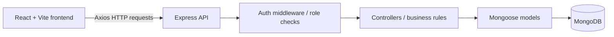

# Architecture — Hotel Management

## 1. Status and principles

This is the proposed implementation architecture based on the source documents. The source specifies a React/Vite client, Node.js/Express backend, MongoDB/Mongoose persistence, Axios requests, JWT authentication, password hashing, and an MVC-style organization. It does not contain an existing application codebase, so exact file names and routes must be confirmed during implementation.

Architecture principles:

- Keep the project small and comprehensible for a full-stack course submission.
- Preserve the documented customer/admin flows and UI reference.
- Separate React UI, HTTP/API calls, Express routes/controllers, and Mongoose models.
- Validate important data at the server boundary.
- Do not add frameworks or services without a clear need.
- Keep documentation recommendations distinct from source facts; mismatches are in `DECISIONS_AND_CONFLICTS.md`.

## 2. Technical architecture concepts from the source

The original Technical Architecture document names these logical components: **User Interface**, **Web Server**, **API Gateway**, **Authentication**, and **Database**. It describes the API Gateway as a double entry point for user/admin requests that routes requests to their services. The source does not identify a separate gateway product or separately deployed gateway service.

**Proposed mapping:** the React/Vite application is the User Interface; the Node.js/Express application is the Web Server and API entry point; Express routes plus JWT/role middleware route customer/admin requests; Mongoose/MongoDB handle persistence. This keeps the architecture simple while representing the logical responsibilities in the source. Do not add a separate gateway service unless the owner/evaluator explicitly expects one.

## 3. High-level components



### Frontend

Responsibilities:
- Public pages and navigation.
- Login and registration forms.
- Customer dashboard, room listing, booking dates and booking history.
- Admin tab interface: All Bookings, All Rooms, Add Room and All Users.
- Call API functions through a shared Axios service/module.
- Handle token/session state and display loading, empty, success and error states.

Technologies explicitly referenced: React, Vite, JSX, CSS, Bootstrap, Axios and `mdb-react-ui-kit`; additional UI packages are listed in notes but should not all be installed automatically. The course material specifically names MDBTabs for the admin interface.

### Backend

Responsibilities:
- Express application setup and middleware.
- Authentication and authorization.
- Room query and creation.
- Booking creation, availability validation, history and cancellation.
- Admin data access for bookings, rooms and users.
- Centralized error responses and data validation.

Technologies referenced: Node.js, Express, Mongoose, `bcryptjs`, `jsonwebtoken`, `cors`, `dotenv`, `multer`, Nodemon, and `body-parser` in the backend screenshot. Multer is relevant only if local file uploads are actually implemented; a remote image URL input may be simpler if the source/rubric does not require file upload.

### Database

MongoDB via Mongoose. Source entities are User, Room and Booking. `DATABASE.md` captures attributes and relationships; raw card storage shown in the ER diagram is explicitly not to be implemented without a safe provider-based design.

## 4. Suggested folder structure

The following is a **proposed normalized structure**, not a claim about current source files. The source alternates `Client/Server`, `client/server`, and uses both `server.js` and `index.js`.

```text
HotelManagement/
├── client/
│   ├── public/
│   ├── src/
│   │   ├── assets/
│   │   ├── components/
│   │   ├── pages/
│   │   ├── services/        # Axios/API calls
│   │   ├── context/         # optional auth/session context
│   │   ├── routes/          # public/protected route handling
│   │   ├── utils/
│   │   ├── App.jsx
│   │   └── main.jsx
│   ├── package.json
│   └── .env.example
├── server/
│   ├── config/              # Mongo connection/config
│   ├── models/              # User, Room, Booking
│   ├── controllers/         # request/business logic
│   ├── routes/              # route definitions
│   ├── middleware/          # auth, roles, validation, errors
│   ├── utils/
│   ├── index.js             # proposed entry point; see conflicts log
│   ├── package.json
│   └── .env.example
├── reference-assets/        # supplied reference screenshots
├── README.md
└── docs at repository root
```

## 5. MVC responsibility map

- **Model layer:** Mongoose schemas and database operations.
- **Controller layer:** input handling, validation, business rules and response status/body.
- **Routing layer:** HTTP path/method declarations and associated middleware/controller.
- **Frontend view layer:** React pages/components that render state and call API services.

This follows the source MVC document, which describes models as data/schema logic, controllers as request-processing logic, and routes as HTTP entry points.

## 6. Core data flow

### Login

1. React validates required inputs at a basic level.
2. Axios sends email/password to the documented login route.
3. Express finds the account and compares the submitted password against the saved hash.
4. On success, server returns user-safe fields and a JWT.
5. The client stores session information consistent with the documented localStorage flow; secrets and password hashes are never returned.
6. Route/dashboard selection depends on the authorized role, not a client-supplied role alone.

### Booking

1. Customer selects a room and arrival/departure dates.
2. Frontend submits the selection to the backend.
3. Backend validates date range and current availability, then calculates duration/amount server-side.
4. Backend persists a Booking referencing the customer and room.
5. Customer can retrieve their own booking list and cancellation changes status through the backend.

### Add room

1. Administrator opens Add Room.
2. Client submits the documented room attributes.
3. Server verifies JWT and admin role, validates the request, and persists a Room document.
4. The All Rooms tab refreshes from the API.

## 7. Runtime configuration

Use environment variables for the API port, Mongo connection string, JWT secret, and frontend API base URL. The specific source examples disagree on port and database name; see `DECISIONS_AND_CONFLICTS.md`. Commit `.env.example` placeholders only, never live keys or credentials.

## 8. Error handling

Use consistent API errors for invalid data, invalid credentials, forbidden access, missing records, unavailable dates, duplicate records, and unexpected server failures. Avoid returning stack traces or secret values to the client. Log enough server-side detail to debug without storing passwords or payment data.

## 9. Technical non-goals for the first submission

No microservices, elaborate role-management framework, distributed queue, multi-hotel tenancy, or broad observability setup unless the source owner requests them. One reliable end-to-end implementation is the priority.
