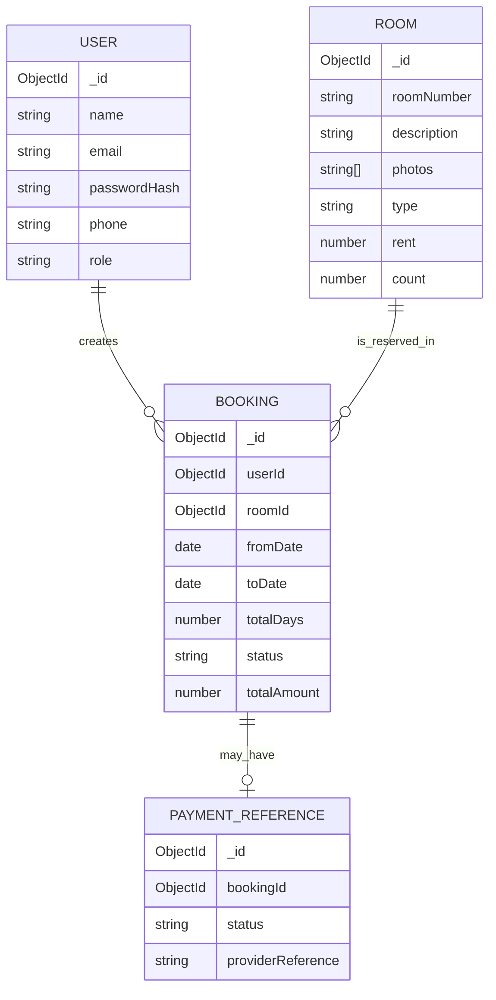

# Database Specification — Hotel Management

## 1. Source entities

The ER Diagram document names **User**, **Room**, **Booking**, and **CardDetails**. It states that one user can create many bookings, a booking references a user and a room, and room records track current bookings/availability. The exact relation/cardinality notation in the diagram is not perfectly consistent with the written list; the proposed implementation below keeps the core entities and flags that issue instead of silently pretending the diagram is a finalized physical schema.

## 2. User entity

| Attribute in source | Meaning from source | Implementation note |
|---|---|---|
| `user_id` | User identifier | MongoDB `_id` may serve as primary identifier; preserve/expose a booking-safe identifier in API responses if required |
| `name` | Person's name | Required |
| `email` | Login email | Required; enforce unique index and normalize consistently |
| `password` | Password | Store only a password hash |
| `c_password` | Confirm password | Validate in frontend/backend request; do not persist as a stored user field |
| `phone` | Contact phone | Required by source flow; validate format reasonably |
| `type` / `userType` / `role` | Admin or customer/ordinary role | Names differ across documents; see conflicts log. Enforce role checks on server |

Source role labels include `admin`, `customer`, `Ordinary`, `Admin`, `type`, `userType`, and `role` in different places. Pick one canonical field after reading `DECISIONS_AND_CONFLICTS.md`; map compatibility only where it genuinely helps.

## 3. Room entity

| Attribute in source | Meaning from source | Implementation note |
|---|---|---|
| `room_id` | Room identifier | MongoDB `_id` is acceptable if application-facing room IDs remain consistent |
| `roomNumber` | Room number | Use a uniqueness rule if each record means one physical room |
| `description` | Room description | Text displayed in room card/details |
| `photos` | Room photos | Define whether this is URLs or uploaded asset references; source does not settle it |
| `type` | Single/double/suite/etc. | Used in room cards and booking history |
| `rent` | Room rental price | Monetary amount; validate non-negative numeric value and use server-side total calculation |
| `count` | Availability/inventory count | Semantics need confirmation: number of identical units or a display counter; see conflicts log |
| `currentBookings` | Current reservation details | Source describes dates/status/booking/user identifiers; avoid duplicate independent truth if bookings are stored separately |

The source feature list calls for viewing available rooms and adding rooms with type, price, images, and details. Editing/deleting rooms is marked as a potential extension, not a confirmed must-have.

## 4. Booking entity

| Attribute in source | Meaning from source | Implementation note |
|---|---|---|
| `booking_id` | Booking identifier | MongoDB `_id` may be used; show a stable booking ID in UI |
| `room_id` | Booked room reference | Reference to Room |
| `user_id` | Customer reference | Reference to User; enforce ownership on customer operations |
| `fromdate` | Arrival/check-in date | Validate as a valid date |
| `todate` | Departure/check-out date | Must be after `fromdate` |
| `totaldays` / `totaldays` in screenshots | Duration | Calculate on server; don't trust client-supplied total |
| `status` | Active/cancelled in features | Use documented status values; any extra payment/pending state needs explicit need |
| `totalAmount` | Total booking amount | Calculate server-side from price × duration or confirmed pricing rules |
| `name` | Guest/customer name | Present in source list; clarify whether snapshot or derived from User |

Booking UI fields explicitly listed in the Features document: booking ID, room type, dates, total amount, phone and status.

## 5. Card/payment entity — security boundary

The source ER diagram lists `CardDetails` attributes including `cardNumber`, `cvvcode`, `expmonthyear`, and `cardholdername`, linked to a booking. This is a source-derived description of the original sketch, **not a recommendation to store payment-card secrets**.

Do not persist raw card numbers, CVVs, or expiration data. The course documents do not name a payment provider, merchant configuration, or payment API. For a course demonstration, use an explicitly simulated payment/booking confirmation or store only a safe payment status/reference. If the evaluator explicitly requires real payment, confirm the provider and use its secure checkout/tokenization model rather than creating a card-details collection.

## 6. Relationships

The diagram above is a **proposed implementation view** of the source concepts. `PAYMENT_REFERENCE` replaces unsafe raw-card persistence in the recommended implementation; it is not a claim that the original ERD already contains this safe form.

## 7. Booking availability rule

Because the user-flow describes selecting arrival/departure dates, availability must be checked for that date range. For a single physical `roomNumber`, an active booking overlaps a requested range when:

`existing.fromDate < requested.toDate AND existing.toDate > requested.fromDate`

A matching active booking means that physical room is unavailable for the requested interval. If `count` is intended to represent multiple identical units, the implementation must track and check quantity/capacity correctly; simply checking one room document is not enough. The source does not precisely define whether room documents represent physical rooms or room types with counts, so this needs explicit confirmation.

## 8. Indexes and constraints (proposed)

- Unique normalized User email.
- Room `roomNumber` unique only if each document is a physical room; do not add a uniqueness constraint if `Room` represents a room type with a count.
- Booking indexes on `userId`, `roomId`, dates and status for common lookup.
- Validate `toDate > fromDate`, non-negative rent, and allowed status values.
- Enforce booking ownership and admin permissions in controllers/middleware, not only in UI.

## 9. Seed data

For demo reproducibility, a seed script may create a small set of sample rooms and one known administrator account through trusted server-side configuration. Never commit real passwords or API secrets. Do not allow arbitrary public registration to create admin accounts by passing a role field.
