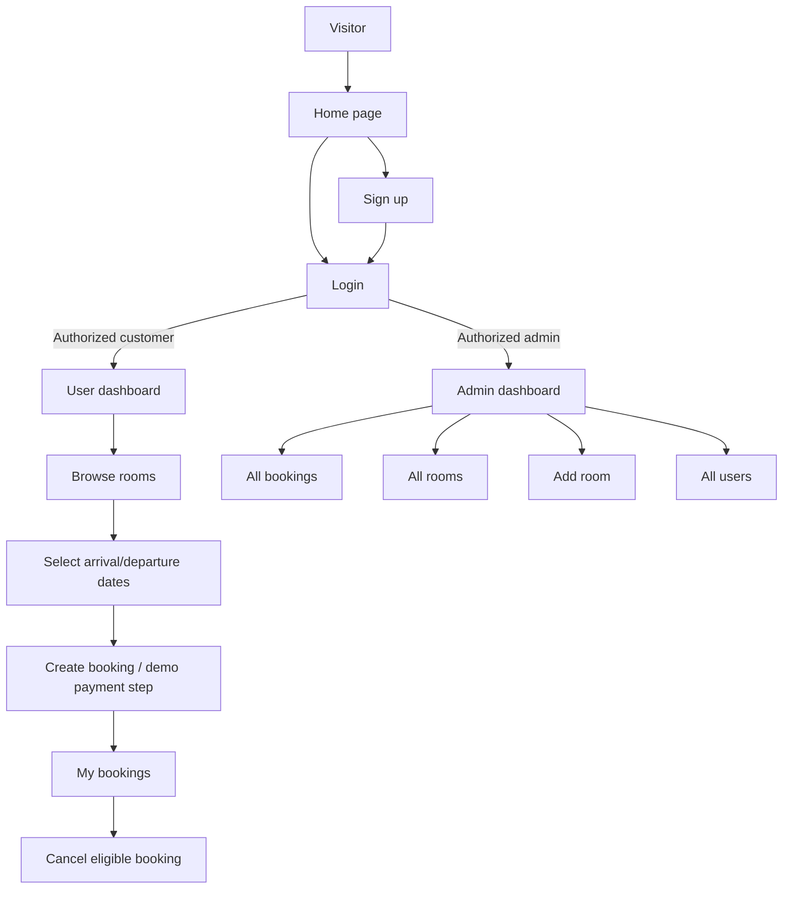

# HotelPro — Solution Overview

**Project category:** Full-stack web application / hotel booking and management  
**Course context:** Full Stack Development on Skill Wallet  
**Document status:** Specification and planning reference; not evidence of completed implementation  
**Working product name:** HotelPro (pending owner confirmation; see `DECISIONS_AND_CONFLICTS.md`)

## 1. The idea in one minute

HotelPro is a hotel booking and management web application. Visitors can explore room offerings and create an account. Customers can sign in, browse rooms, choose arrival and departure dates, make bookings, review booking history, and cancel bookings according to status. Administrators can review bookings, inspect and add rooms, and view registered users.

The supplied course material describes a React/Vite frontend, Node.js/Express backend, MongoDB database accessed through Mongoose, Axios API calls, JWT authentication, password hashing, and an admin interface using tabs. This document set preserves that direction rather than switching frameworks or inventing unrelated product features.

## 2. Course skills named in the source overview

The overview lists JavaScript, React/JSX, CSS, Node.js, MongoDB, Express.js, JWT, Bootstrap, asynchronous JavaScript and HTML as required skills. This is a course-oriented skill list, not a requirement to install every optional frontend UI library listed elsewhere.

## 3. Primary users

### Visitor

- View the public landing page, room highlights, and About information.
- Navigate to registration or login.
- Preview rooms as allowed by the implemented public experience.

### Customer / ordinary user

- Register and log in.
- Receive a personalized greeting on the user dashboard.
- Browse room details and pricing.
- Select a check-in/arrival date and check-out/departure date.
- Book a room and review the resulting booking.
- View booking history including booking ID, room type, dates, total amount, phone, and status.
- Cancel an eligible booking; cancelled bookings must remain visibly cancelled.
- Log out.

### Administrator

- Log in through the same system with an authorized administrator account.
- View all bookings and their statuses.
- View room inventory.
- Add rooms with the documented room details, including type, rent/price, images/photos, room number, description and availability/count as applicable.
- View registered users.
- Log out.

## 4. Main user journey

## 5. Product areas

1. **Public website:** navigation, hero/room carousel, About section, room preview.
2. **Authentication:** registration, login, validation, session token, protected routes.
3. **Customer experience:** dashboard, room browser, booking form, booking history, cancellation.
4. **Admin experience:** tabbed management view for all bookings, all rooms, adding rooms and all users.
5. **Backend/API:** Express application, routes, controller logic, middleware and error handling.
6. **Database:** User, Room and Booking documents with relationships represented by identifiers and/or documented current-booking data.
7. **Course delivery:** clean GitHub repository, working demo video link, Skill Wallet submission.

## 6. What this project is not

The source notes include unrelated generic examples mentioning products, courses, instructors, students and doctors. Those words are not part of the hotel-specific feature set and must not become features unless the owner explicitly asks for them. Advanced hotel-chain management, real payment-provider integration, email/SMS messaging, analytics, and deployment automation are not established as required features in the accessible source documents.

## 7. Important boundaries

- Use the actual provided screenshots as visual reference; do not assume the illustrative text in this file replaces those screenshots.
- Keep the documented user/admin roles and booking lifecycle.
- Store passwords as hashes, never as plaintext.
- The source ER diagram lists raw card details; the implementation must not persist card numbers or CVVs. A simulated payment/demo confirmation can represent the payment step until a provider requirement is confirmed.
- Do not let a public signup request grant administrator rights without a trusted provisioning mechanism. The source role-selector requirement is recorded for project-owner review in `DECISIONS_AND_CONFLICTS.md`.
- Keep design and implementation achievable for a course submission; prioritize complete core workflows over unrelated additions.

## 8. How to use this overview

Read `PRD.md` for requirements and acceptance tests, then `DECISIONS_AND_CONFLICTS.md` for unresolved source inconsistencies. Read the technical documents before coding. The Antigravity instructions in `CREATE_PROMPT.md` must instruct the agent to inspect, implement in stages, and report test evidence honestly.
